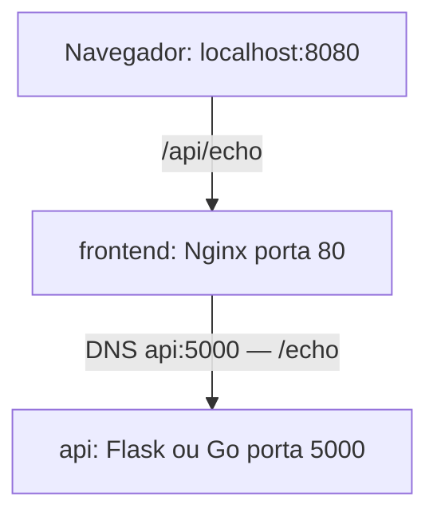

# Docker Compose Practical Guide
Guia neutro e autoral de estudo e prática: construir imagens, conectar containers, encaminhar HTTP, investigar falhas e comprovar resultados. Para quem inicia com Docker e para quem precisa de consulta rápida. A Echo App apenas devolve mensagens, sem domínio institucional ou empresarial.

Pré-requisitos: Docker com daemon acessível, Docker Compose com suporte a service_healthy, Bash, curl e Python 3 para scripts. Internet para obter imagens/dependências; portas 8080, 8081, 8082 ou 8090 livres conforme o exemplo. Node e Go locais são opcionais. Scripts foram escritos para ambiente Linux; no Windows use WSL ou Bash compatível.

## Início rápido — cinco comandos

Para acompanhar toda a prática, siga o [passo a passo de estudo e execução](docs/passo-a-passo.md), com comandos, resultados esperados e sequência dos exercícios.

```bash
cd examples/01-basic-compose
docker compose config
docker compose up --build -d
docker compose ps
curl -f http://localhost:8080/api/health
```
Aguarde a API ficar pronta se o primeiro curl falhar. Abra http://localhost:8080 e envie uma mensagem. Ao terminar, execute `docker compose down` nessa mesma pasta.



## Mapa e trilha

| Diretório | Conteúdo |
| --- | --- |
| [docs](docs/quick-reference.md) | consulta e conceitos |
| [examples/01-basic-compose](examples/01-basic-compose/README.md) | rede padrão, estático e Flask |
| [examples/02-multistage-web](examples/02-multistage-web/README.md) | React, venv, rede explícita, saúde |
| [examples/03-minimal-runtime](examples/03-minimal-runtime/README.md) | Go estático e scratch |
| [exercises/01-complete-the-compose](exercises/01-complete-the-compose/README.md) | Compose incompleto |
| [exercises/02-go-multistage](exercises/02-go-multistage/README.md) | substituir API preservando frontend |
| [exercises/03-debugging-scenarios](exercises/03-debugging-scenarios/README.md) | dez falhas deliberadas |
| [reference-solutions](reference-solutions/README.md) | soluções separadas |
| [templates](templates/README.md) | padrões e perguntas autorais |
| scripts/ | validação e encerramento delimitados |

Trilha: leia responsabilidades e rede; execute o básico; complete exercício 1; estude build, cache e multi-stage; execute avançado e mínimo; tente exercício Go; investigue os dez cenários; registre decisões pelo 5C.

## Problema → referência

| Problema | Documento ou exemplo |
| --- | --- |
| Confundo construção e execução | [Build/runtime](docs/01-build-vs-runtime.md) |
| Não sei em qual arquivo configurar | [Responsabilidades](docs/02-dockerfile-compose-nginx.md) |
| DNS, localhost, EXPOSE e ports | [Rede e portas](docs/03-networking-and-ports.md) |
| Imagem tem compilador desnecessário | [Multi-stage](docs/04-multistage-build.md) |
| Cache, código antigo e COPY | [Cache/contexto](docs/05-cache-and-build-context.md) |
| Dados desaparecem | [Persistência](docs/06-persistence.md) |
| Build, 502, 404 ou Exited | [Diagnóstico](docs/07-debugging.md) |
| Preciso demonstrar sucesso e erro | [Validação](docs/08-validation-and-evidence.md) |
| Preciso explicar uma decisão | [5C](docs/09-method-5c.md) |

## Validar

Na raiz:

```bash
python3 scripts/validate-static.py
./scripts/validate-basic.sh
./scripts/validate-multistage.sh
python3 scripts/test-contract.py
./scripts/test-go.sh
```
Para `test-contract.py`, instale as dependências Flask em um ambiente virtual com `python3 -m venv .venv`, `.venv/bin/pip install -r examples/01-basic-compose/api/requirements.txt` e execute `.venv/bin/python scripts/test-contract.py`. Para `test-go.sh`, tenha Go 1.23 ou superior instalado.

Os scripts Docker mostram config, up --build, ps e testes HTTP e encerram apenas seu projeto. Não rode ambos simultaneamente na porta 8080. `./scripts/cleanup.sh NOME_DO_PROJETO` encerra somente o projeto isolado do validador; um exemplo iniciado manualmente deve ser encerrado com down na própria pasta.

Escreva registros e documentação com palavras próprias. Templates fazem perguntas; soluções servem para comparação após a tentativa. Não há registro final preenchido em nome de outra pessoa.

Limitações: material de treinamento, sem autenticação, persistência ou preparação para produção. Tags são explícitas, mas não fixadas por digest. `depends_on` básico não garante prontidão. Os cenários contêm defeitos deliberados; exercícios incompletos não constroem antes da sua implementação. Os exemplos funcionam sem arquivos de referência externos. Consulte [testes realmente executados e limitações](docs/validation-report.md).

Licença do conteúdo original: [MIT](LICENSE). Dependências e imagens mantêm suas licenças próprias.
